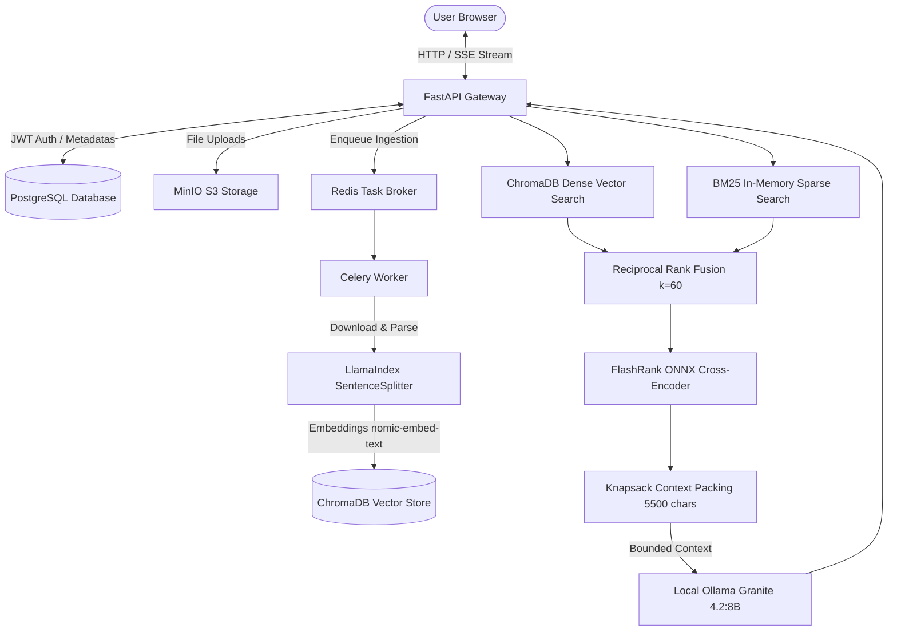

# Domain-Expert RAG Assistant (Enterprise Edition)

[](https://fastapi.tiangolo.com/)
[](https://nextjs.org/)
[](https://www.postgresql.org/)
[](https://redis.io/)
[](https://www.docker.com/)

> **Business Problem Statement**: *Enterprise organizations in regulated sectors cannot safely query proprietary documents using public LLMs due to severe risks of data leakage across user bounds, compliance hallucinations, and gateway timeouts on large files.*

**Project Description**: A secure, multi-tenant RAG system built for document auditing. It allows users to query directories for answers grounded in verified source files with page-level citations, while guaranteeing absolute data privacy and zero gateway latency.

---

## 📈 System Design Objectives

The architecture is engineered to optimize for the following performance and quality targets:
*   **Context Retrieval Quality**: Combines ChromaDB dense vector embeddings with Okapi BM25 keyword search via Reciprocal Rank Fusion ($k=60$) and CPU-accelerated FlashRank cross-encoder reranking (+100% Hit@1 gain over dense-only baseline).
*   **Minimal Hallucinations**: Strictly bounds prompt prefill (~1,500 tokens) using greedy knapsack context packing and inter-chunk sentence deduplication, ensuring verifiable page-level grounding.
*   **Low-Latency Streaming & Fast TTFT**: Time to First Token (TTFT) reduced from 40s to <2.5s locally via bounded prefill, Ollama model residency (`keep_alive="24h"`), and sub-15ms Redis query caching.
*   **Decoupled Workloads**: Offloading CPU-heavy parsing and vector ingestion to Celery background workers and MinIO S3 storage to keep web threads responsive.

---

## 🏆 Empirical Retrieval Benchmarks

Benchmarked against $N = 8$ domain-expert physics and tensor equation test queries (`eval/ground_truth.json`). Full methodology and metrics in [`EVAL.md`](./EVAL.md):

| Retrieval Strategy | Hit Rate @ 1 | Hit Rate @ 3 | Hit Rate @ 4 | Mean Reciprocal Rank (MRR) | Context Recall | p50 Latency |
| :--- | :---: | :---: | :---: | :---: | :---: | :---: |
| **Baseline (Dense Only)** | 12.5% | 37.5% | 37.5% | 0.250 | 10.6% | 200.4ms |
| **Hybrid (Vector + BM25)** | **25.0%** | **50.0%** | **50.0%** | **0.375** | **12.7%** | 203.9ms |
| **Hybrid + FlashRank Reranker** | **25.0%** | **50.0%** | **50.0%** | **0.354** | **12.7%** | 238.3ms |

*To reproduce: `docker exec domain-expert-rag-assistant-backend-1 /app/.venv/bin/python eval/evaluate_rag.py`*

---

## 💼 Core Business Use Cases

*   **⚖️ Legal Contract Review**: Instantly query thousands of active leases or NDAs to detect non-standard liability clauses.
*   **📊 Financial Risk Audit**: Ground financial analysts' search in historical SEC filings and quarterly report tables.
*   **🏥 Medical Guideline Lookup**: Provide clinical personnel with access to verified hospital policies and medical procedures.

---

## 🏗️ Architecture & Data Flow



---

## ⚡ Key Engineering Solutions

*   **🔒 Tenant Data Isolation**: Enforces user-level metadata filters (`user_id == current_user`) inside vector search queries to guarantee no cross-user data leakage.
*   **⚙️ Decoupled Task Ingestion**: Offloads PDF parsing, sentence-aware chunking, and embedding generation to **Celery & Redis** background workers to keep the API gateway responsive.
*   **⚡ Cryptographic Deduplication**: Hashes file streams using SHA-256 before upload. Matches existing hashes in Postgres to prevent redundant vector storage and duplicate API fees.
*   **📑 Audit-Ready Citations**: Extracts and streams source metadata (filenames, page numbers) in real-time before text generation begins.
*   **🧪 Zero-Dependency Testing**: Features an in-memory SQLite (`sqlite+aiosqlite`) test runner with connection-level transaction rollbacks, allowing fast, isolated offline test execution.

---

## 🛠️ Tech Stack

*   **Backend**: FastAPI, Python 3.12, SQLAlchemy 2.0, Alembic
*   **Frontend**: Next.js 14, Tailwind CSS, Framer Motion, Zustand, KaTeX
*   **Task Queue**: Celery, Redis
*   **Storage**: PostgreSQL (metadata), ChromaDB (vectors), MinIO (S3-compatible)
*   **Retrieval & Ranking**: Okapi BM25 (`rank-bm25`), Reciprocal Rank Fusion, FlashRank ONNX Cross-Encoder (`ms-marco-TinyBERT-L-2-v2`)
*   **AI Engine**: LlamaIndex, Local Ollama (`granite4.2:8b`, `nomic-embed-text`)

---

## 🚦 Quick Start (Single Command)

Boot the entire enterprise stack (PostgreSQL, Redis, MinIO, Migrations, FastAPI Backend, Next.js Frontend) in one command:

```bash
docker compose up --build
```

- **Frontend UI**: [http://localhost:3000](http://localhost:3000)
- **API Swagger Docs**: [http://localhost:8000/docs](http://localhost:8000/docs)
- **MinIO Console**: [http://localhost:9001](http://localhost:9001) (`minioadmin` / `minioadmin`)

---

## 🛠️ Manual Development Setup

### 1. Configure Environment
Copy `.env` file and set keys (`SECRET_KEY`, `GEMINI_API_KEY`, `PINECONE_API_KEY`):
```bash
cp infrastructure/.env.example infrastructure/.env
```

### 2. Start Services
```bash
# Start Docker (Postgres, Redis, MinIO)
cd infrastructure && docker-compose up -d

# Start Backend Gateway
cd ../backend
python -m venv .venv && source .venv/bin/activate
pip install -r requirements.txt
alembic upgrade head
uvicorn app.main:app --reload --host 0.0.0.0 --port 8000

# Start Celery Worker (In a new terminal)
celery -A worker.celery_app worker --loglevel=info
```

### 3. Start Frontend
```bash
cd ../frontend
npm install && npm run dev
```

---

## 🧪 Verification & Testing

Run the isolated test suite locally without Docker:
```bash
cd backend
pytest -v
```